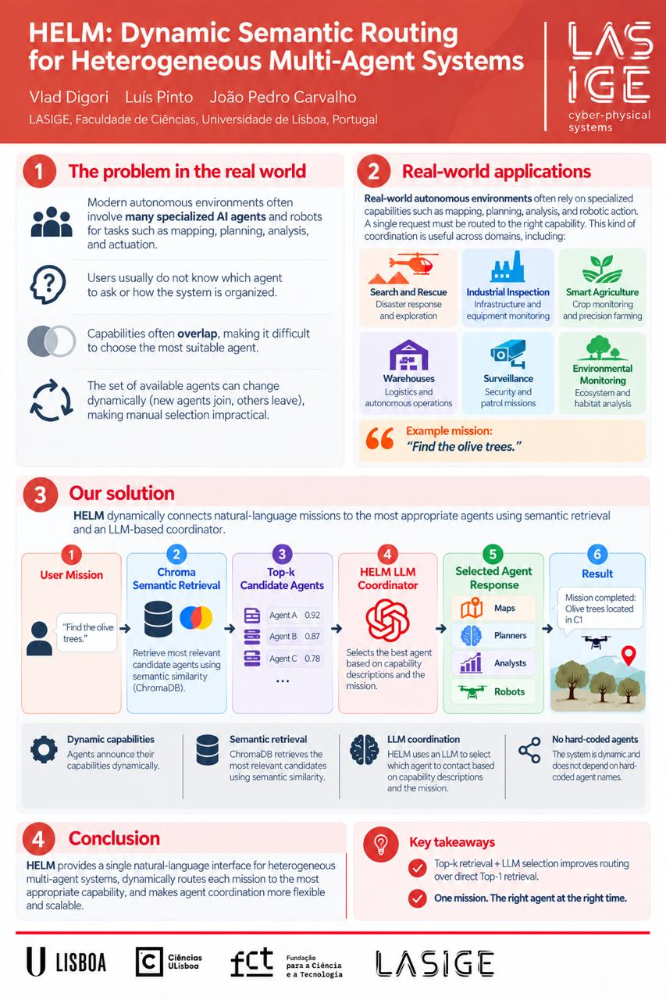
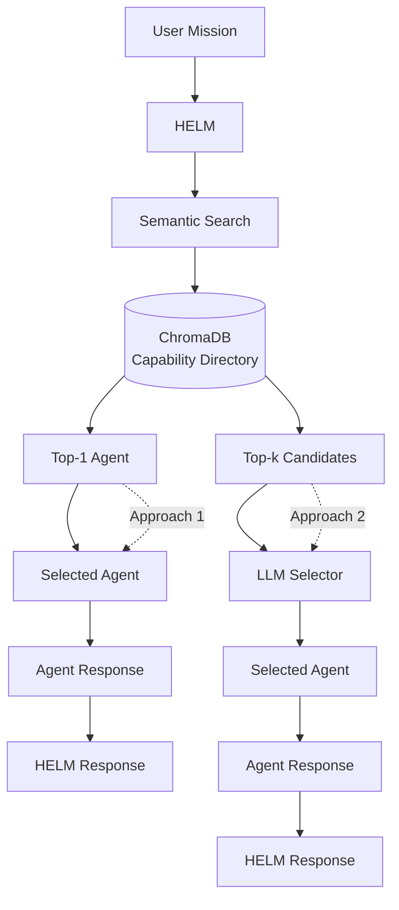
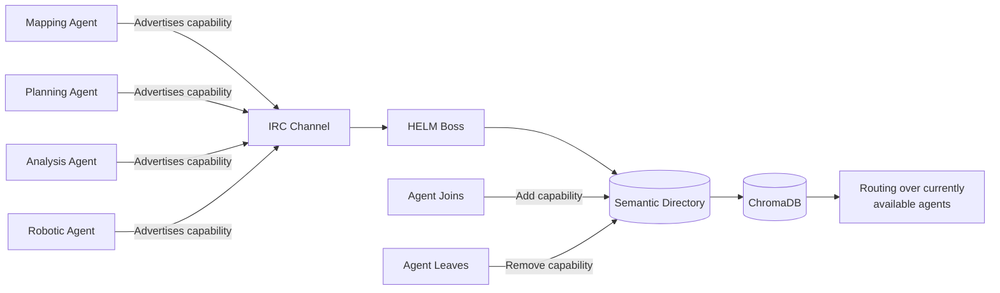
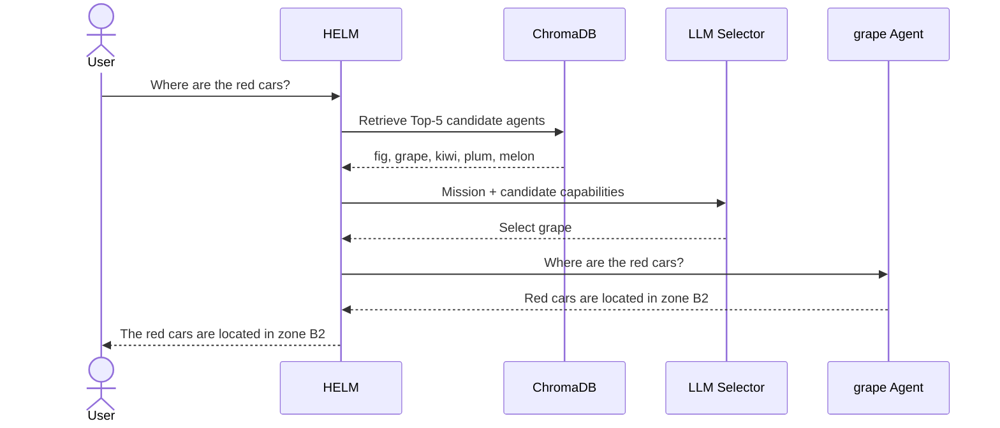
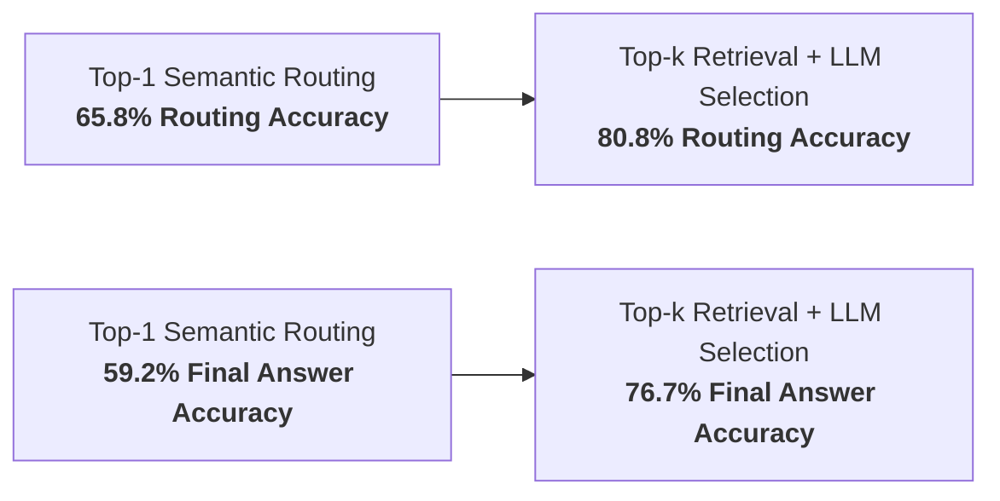

# HELM

## Dynamic Semantic Routing for Heterogeneous Multi-Agent Systems

**HELM** is a research project for dynamically routing natural-language missions to specialized robotic and software agents using semantic retrieval and LLM-assisted selection.

Developed at **LASIGE, Faculty of Sciences, University of Lisbon**.

> The main HELM implementation is maintained in a private research repository.  
> This repository provides a public technical overview of the architecture, evaluation, research paper, poster, and project results.

---

## Highlights

- Evaluated on **120 natural-language missions**
- Tested across **12 heterogeneous specialist agents**
- Improved routing accuracy from **65.8% to 80.8%**
- Improved final HELM answer accuracy from **59.2% to 76.7%**
- Combines **semantic retrieval with LLM-based candidate selection**
- Supports **dynamic agent discovery and capability announcements**
- Recipient of the **Outstanding Research Award — LASIGE Summer of Research 2026**

---

## Poster

<p align="center">
  
</p>

---

## The Problem

Modern autonomous systems may contain multiple specialized agents with different capabilities, including:

- mapping;
- planning;
- environmental analysis;
- information retrieval;
- robotic actuation.

A user should not need to know which specific agent is responsible for a task.

Agent selection becomes more difficult when:

- several agents expose overlapping capabilities;
- agents dynamically join or leave the system;
- natural-language requests describe goals rather than agent names;
- semantically similar agents perform different operational roles.

HELM treats this as a **dynamic semantic routing problem**.

---

## The Solution

HELM maintains a live semantic representation of the agents currently available in the system.

Each agent advertises a natural-language description of its capabilities. These descriptions are converted into embeddings and indexed in **ChromaDB**.

When a mission arrives:

1. The mission is embedded.
2. ChromaDB retrieves semantically relevant agents.
3. HELM applies one of two routing strategies:
   - **Top-1 semantic routing** — directly select the closest agent.
   - **Top-k retrieval + LLM selection** — retrieve several candidates and let an LLM choose the most appropriate agent.
4. The selected specialist receives the mission.
5. HELM collects the specialist response.
6. HELM produces the final user-facing result.

---

## Architecture

HELM evaluates two routing strategies.



### Approach 1 — Direct Top-1 Semantic Routing

The mission is embedded and compared against the capability descriptions of the currently available agents.

The closest semantic match is directly selected.

### Approach 2 — Top-k Retrieval + LLM Selection

Instead of committing immediately to the nearest semantic match, ChromaDB retrieves multiple candidate agents.

The original mission and candidate capability descriptions are then given to an LLM, which performs the final agent selection.

This separates **candidate retrieval** from **final routing selection**.

---

## Dynamic Agent Discovery

HELM does not depend on a hard-coded list of agents.

Agents advertise their capabilities dynamically, and the semantic directory is updated as agents join or leave the system.



An agent announcement conceptually contains information such as:

```text
nick=<agent>
family=<family>
subfamily=<subfamily>
description=<natural-language capability>
```

This allows HELM to route missions according to the capabilities that are available **at runtime**.

---

## Example Mission

A simplified interaction from the HELM evaluation:



The semantic retrieval stage narrows the search space while the LLM performs the final capability comparison.

---

## Evaluation

HELM was evaluated on:

- **120 natural-language missions**
- **12 specialist agents**
- **10 missions per expected agent**

Four routing configurations were compared:

| Configuration | Retrieval | Selector | k |
|---|---|---|---:|
| R1 | ChromaDB | None | 1 |
| R2 | ChromaDB | Gemma4 31B | 5 |
| R3 | ChromaDB | GPT-OSS 120B | 5 |
| R4 | ChromaDB | Nemotron-3 Super | 5 |

### Main Results

| Metric | Top-1 Baseline | Best Hybrid Result |
|---|---:|---:|
| Retrieval Recall | 65.8% | 81.7% |
| Routing Accuracy | 65.8% | **80.8%** |
| HELM Final-Answer Accuracy | 59.2% | **76.7%** |



The results show that preserving several semantic candidates before final selection can outperform relying only on the nearest embedding match.

For the full benchmark setup, metric definitions, complete results table, and failure analysis, see:

**[Evaluation Details](docs/evaluation.md)**

---

## My Contributions

My work on HELM included:

- designing and implementing the semantic routing architecture;
- integrating ChromaDB-based capability retrieval;
- implementing Top-k candidate retrieval and LLM-assisted selection;
- developing dynamic agent discovery and capability announcements;
- building benchmarking and evaluation tooling;
- measuring retrieval, routing, agent-answer, and final-response performance;
- implementing stage-level failure analysis;
- comparing multiple LLM selector configurations;
- contributing to the research paper;
- designing and presenting the research poster.

---

## Tech Stack

### AI & Retrieval

- Large Language Models
- Semantic embeddings
- ChromaDB
- Vector similarity search
- Top-k retrieval
- LLM-based candidate selection

### Multi-Agent Systems

- Dynamic agent discovery
- Capability-based routing
- Agent orchestration
- IRC-based communication
- Heterogeneous software and robotic agents

### Robotics

- ROS 2
- Robotic agents
- Mission execution
- Heterogeneous autonomous systems

### Evaluation

- Retrieval recall
- Routing accuracy
- Agent-answer accuracy
- Final-answer accuracy
- Failure decomposition
- Benchmark automation

### Development

- Python
- JSON
- Git
- Linux

---

## Design Principles

### Dynamic Rather Than Hard-Coded

HELM routes according to advertised capabilities rather than fixed agent names embedded directly in the orchestration logic.

### Retrieval Before Reasoning

The LLM does not search the entire agent population. ChromaDB first narrows the search space to a small set of semantically relevant candidates.

### Capability-Based Routing

Agents are represented by what they can do rather than by fixed identifiers.

### Stage-Level Observability

Retrieval, routing, specialist execution, and final response generation are evaluated independently.

---

## Limitations

The current research evaluation uses a controlled benchmark containing **12 agents and 120 missions**.

Current limitations include:

- overlapping capability descriptions between some agents;
- dependency on the expected agent being present in the retrieved candidate set;
- additional LLM inference cost for hybrid routing;
- limited evaluation with very large agent populations;
- limited evaluation on physical robotic deployments.

The current results therefore demonstrate the effectiveness of the routing architecture within the evaluated environment rather than arbitrary-scale performance.

---

## Future Work

Planned research directions include:

- adaptive Top-k selection;
- routing confidence thresholds;
- improved capability descriptions;
- alternative re-ranking strategies;
- automatic capability learning;
- latency and computational-cost benchmarking;
- evaluation with larger agent populations;
- physical robotic deployments;
- explainable routing traces.

---

## Research Materials

### Paper

**HELM: Dynamic Semantic Routing for Heterogeneous Multi-Agent Systems**

**Authors**
- Vlad Digori
- Luís Pinto
- João Pedro Carvalho

LASIGE  
Faculty of Sciences  
University of Lisbon, Portugal

[Read the paper](paper/HELM.pdf)

### Poster

<p align="center">
  
</p>

---

## Recognition

**Outstanding Research Award — LASIGE Summer of Research 2026**

Awarded for the research and development of HELM.


## Repository Note

The primary HELM implementation is maintained in a **private research repository**.

This public repository intentionally contains only:

- project documentation;
- architecture diagrams;
- evaluation results;
- research materials;


It does **not** expose private research source code, credentials, internal infrastructure, restricted datasets, or unpublished implementation details.

---

## Authors

### Vlad Digori
LASIGE, Faculty of Sciences, University of Lisbon

### Luís Pinto
LASIGE, Faculty of Sciences, University of Lisbon

### João Pedro Carvalho
LASIGE, Faculty of Sciences, University of Lisbon

---

## Acknowledgements

This work was supported by **FCT through the LASIGE Research Unit**,  
ref. **UID/00408/2025**  
(DOI: `10.54499/UID/00408/2025`).

---

## Contact

**Vlad Digori**

- GitHub: [glemiu6](https://github.com/glemiu6)
- LinkedIn: [Vlad Digori](https://www.linkedin.com/in/vlad-digori-aba257320/)
