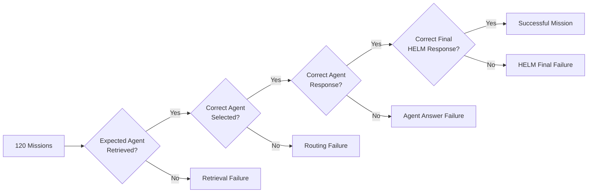
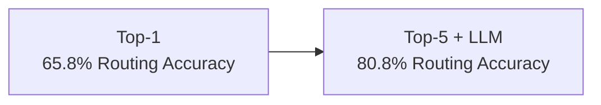
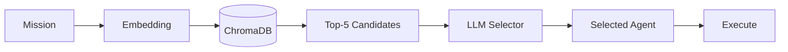
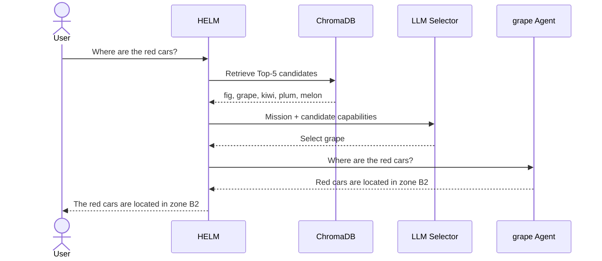

# HELM Evaluation

This document describes the experimental setup, evaluation metrics, routing configurations, benchmark results, and failure analysis used to evaluate **HELM: Dynamic Semantic Routing for Heterogeneous Multi-Agent Systems**.

---

## Experimental Setup

HELM was evaluated on a fixed set of **120 natural-language missions** distributed across **12 specialist agents**, with **10 missions associated with each expected agent**.

The evaluation compares two routing strategies:

1. **Direct Top-1 semantic routing**
2. **Top-5 semantic retrieval followed by LLM-based candidate selection**

The semantic retrieval layer used **ChromaDB**, with `qwen3-embedding:0.6b` generating embeddings for missions and agent capability descriptions.

The specialist agents used `gpt-oss:120b-cloud` to generate task responses throughout the experiments.

These components were held fixed so that differences between runs were primarily attributable to the routing configuration.

---

## Routing Configurations

| ID | Retrieval | Selector | k |
|---|---|---|---:|
| R1 | ChromaDB | None | 1 |
| R2 | ChromaDB | Gemma4 31B | 5 |
| R3 | ChromaDB | GPT-OSS 120B | 5 |
| R4 | ChromaDB | Nemotron-3 Super | 5 |

### R1 — Retrieval-Only Baseline

ChromaDB returns the single nearest agent.

No LLM is used for candidate selection.

### R2 — Top-5 + Gemma4

ChromaDB retrieves the five nearest candidate agents and **Gemma4 31B** selects the final agent.

### R3 — Top-5 + GPT-OSS

ChromaDB retrieves the five nearest candidate agents and **GPT-OSS 120B** selects the final agent.

### R4 — Top-5 + Nemotron

ChromaDB retrieves the five nearest candidate agents and **Nemotron-3 Super** selects the final agent.

---

## Evaluation Metrics

HELM separates the retrieval, routing, specialist-answer, and final-orchestration stages so that failures can be attributed more precisely.

### Retrieval Recall

Measures whether the expected agent is present in the candidate set returned by semantic retrieval.

$$\text{Retrieval Recall}
=\frac{N_{\text{expected agent retrieved}}}
{N_{\text{missions}}}$$

For Top-1 routing, retrieval recall and routing accuracy are equivalent because the candidate set contains only one agent.

---

### Routing Accuracy

Measures how often HELM selects the expected specialist.

$$\text{Routing Accuracy}
=\frac{N_{\text{correct routes}}}
{N_{\text{missions}}}$$

---

### Only Expected Agent Called

Measures the proportion of missions in which only the expected specialist was invoked.

$$
\text{Expected-Only Rate}
=
\frac{N_{\text{only expected agent called}}}
{N_{\text{missions}}}
$$

---

### Agent Answer Accuracy

Measures whether the expected specialist returned the required answer across the complete evaluation set.

$$
\text{Agent Answer Accuracy}
=
\frac{N_{\text{correct agent answers}}}
{N_{\text{missions}}}
$$

---

### Answer Accuracy Given Called

Separates specialist answer quality from routing quality.

$$
\text{Answer Accuracy Given Called}
=
\frac{N_{\text{correct answers from expected agent}}}
{N_{\text{missions where expected agent was called}}}
$$

---

### HELM Final-Answer Accuracy

Measures whether the final user-facing HELM response contains the required answer.

$$
\text{HELM Final-Answer Accuracy}
=
\frac{N_{\text{correct HELM responses}}}
{N_{\text{missions}}}
$$

---

## Evaluation Pipeline

Each mission is evaluated stage by stage.

This distinguishes four major failure types.

### Retrieval Failure

The expected agent is absent from the semantic candidate set.

For Top-k routing, the selector cannot recover from this failure because it can only choose among retrieved candidates.

### Routing Failure

The expected agent is present in the candidate set, but the LLM selects another agent.

### Agent Answer Failure

The correct specialist is selected but its response does not satisfy the required benchmark answer.

### HELM Final Failure

The specialist provides the required information, but the final HELM orchestration response loses, changes, or fails to preserve it.

---

## Complete Results

| Metric | R1 | R2 | R3 | R4 |
|---|---:|---:|---:|---:|
| Retrieval Recall | 65.8% | 81.7% | 81.7% | 81.7% |
| Routing Accuracy | 65.8% | **80.8%** | 77.5% | **80.8%** |
| Only Expected Agent Called | 65.8% | 71.7% | 60.0% | **73.3%** |
| Answer Accuracy Given Called | 89.9% | 87.6% | **92.5%** | 90.7% |
| Agent Answer Accuracy | 59.2% | 70.8% | 71.7% | **73.3%** |
| HELM Final-Answer Accuracy | 59.2% | **76.7%** | 51.7% | 72.5% |

---

## Main Findings

### 1. Top-k Retrieval Improved Candidate Coverage

The Top-1 baseline achieved **65.8% retrieval recall**.

All Top-5 configurations achieved **81.7% retrieval recall**.

This indicates that retaining multiple semantically similar candidates increases the probability that the expected agent remains available for final selection.

---

### 2. Hybrid Routing Improved Routing Accuracy

The Top-1 baseline achieved **65.8% routing accuracy**.

The best Top-5 configurations reached **80.8% routing accuracy**.

This supports the use of a second-stage selector when multiple capabilities occupy similar regions of the semantic space.

---

### 3. Final Performance Depends on More Than Routing

Gemma4 reached the highest HELM final-answer accuracy at **76.7%**.

Nemotron-3 Super reached **72.5%**.

GPT-OSS reached **51.7%**, despite achieving **77.5% routing accuracy** and **71.7% agent-answer accuracy**.

This demonstrates that correct routing alone does not guarantee a correct final response.

The final orchestration stage can still lose, transform, or incorrectly reformulate information returned by the specialist.

---

### 4. Model Size Did Not Directly Predict Routing Quality

Gemma4 31B and Nemotron-3 Super both reached **80.8% routing accuracy**.

GPT-OSS 120B reached **77.5%**.

Within this evaluation, selector quality therefore depended on model behavior and its interaction with the routing prompt rather than simply model scale.

---

### 5. Retrieval Recall Places an Upper Bound on Routing Accuracy

For Top-k routing, the selector can only select agents that appear in the retrieved candidate set.

If the expected specialist is absent from the Top-k candidates, the LLM cannot recover it.

This makes retrieval quality a key limiting factor in the current architecture.

---

## Routing Strategy Comparison

### Direct Top-1 Routing

Advantages:

- simple;
- low routing overhead;
- no additional LLM selector.

Limitations:

- commits immediately to one semantic match;
- discards potentially useful alternatives;
- more vulnerable when multiple agents have overlapping descriptions.

---

### Top-k Retrieval + LLM Selection

Advantages:

- preserves multiple plausible candidates;
- allows operational differences between similar agents to be considered;
- improved routing accuracy in the benchmark.

Limitations:

- requires additional LLM inference;
- cannot recover an agent that retrieval failed to include;
- selector behavior can affect downstream orchestration quality.

---

## Example Evaluation Flow

A mission such as:

> Where are the red cars?

can proceed as:

This illustrates the separation between candidate retrieval, final agent selection, specialist execution, and final orchestration.

---

## Limitations

The evaluation has several important limitations.

### Benchmark Scale

The benchmark contains **12 agents and 120 missions** in a controlled environment.

The current results do not establish how the routing strategies would behave with hundreds of dynamically changing agents or many highly overlapping descriptions.

### Capability Overlap

Some robotic agents expose semantically similar capabilities while operating under different constraints.

Embedding models can recognize that these descriptions are related without necessarily encoding the exact operational distinction required by a mission.

### Retrieval Dependency

The Top-k selector depends on the expected agent being present in the candidate set.

Retrieval failures cannot be corrected by the LLM selector.

### Additional Inference Cost

Hybrid routing introduces an additional LLM call for candidate selection.

The current evaluation does not yet provide a full latency or computational-cost comparison.

### Limited Real-Robot Evaluation

The benchmark primarily evaluates the routing and orchestration architecture in a controlled setting.

Larger real-world robotic deployments remain future work.

---

## Future Evaluation Directions

Future experiments should investigate:

- different values of `k`;
- routing confidence thresholds;
- improved capability descriptions;
- alternative re-ranking methods;
- automatic capability learning;
- routing latency;
- computational cost;
- larger agent populations;
- real robotic deployments;
- explainable routing traces;
- LLM-only routing as an additional baseline.

---

## Summary

The HELM evaluation shows that direct nearest-neighbor semantic routing can be improved by preserving several plausible candidates and applying a second-stage LLM selector.

The best evaluated hybrid configuration increased:

- **retrieval recall:** `65.8% → 81.7%`
- **routing accuracy:** `65.8% → 80.8%`
- **final HELM answer accuracy:** `59.2% → 76.7%`

At the same time, the results show that system performance depends on more than routing alone.

Retrieval quality, specialist answer quality, and final orchestration behavior all contribute to the end-to-end result.

---

[← Back to the HELM overview](../README.md)
